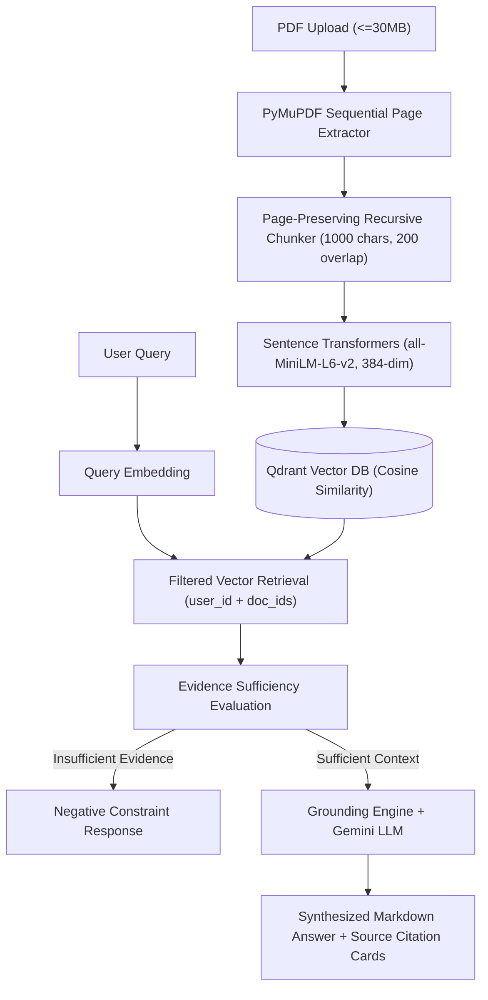

# PaperMind AI — Architecture & Engineering Specification

## 1. System Overview

PaperMind AI is an enterprise-grade academic research assistant using Retrieval-Augmented Generation (RAG). It provides zero-hallucination grounded answers, verifiable page-level citations, multi-paper syntheses, 7-section structured summaries, and comparative matrices.

---

## 2. Component Pipeline

---

## 3. Storage Architecture

1. **Relational Database (`PostgreSQL 16`)**:
   - `users`: Credentials, timestamps, multi-tenant boundaries.
   - `documents`: File paths, SHA-256 hashes, page counts, chunk counts, processing statuses.
   - `chat_sessions`: Conversations, multi-paper scopes, titles.
   - `messages`: User prompts, AI responses, latency records.
   - `citations`: Foreign-keyed to messages and documents, preserving exact page numbers, snippets, and similarity scores.
   - `summaries`: Cached structured 7-section breakdowns.

2. **Vector Database (`Qdrant`)**:
   - Collection: `papermind_chunks`.
   - Vector Dimensionality: 384 (`all-MiniLM-L6-v2`).
   - Distance Metric: `Cosine`.
   - Payload Indexes: `user_id`, `document_id`, `page_number`.
